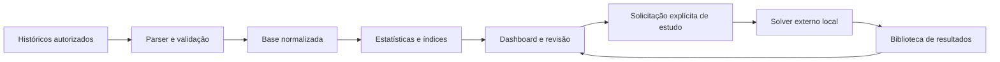
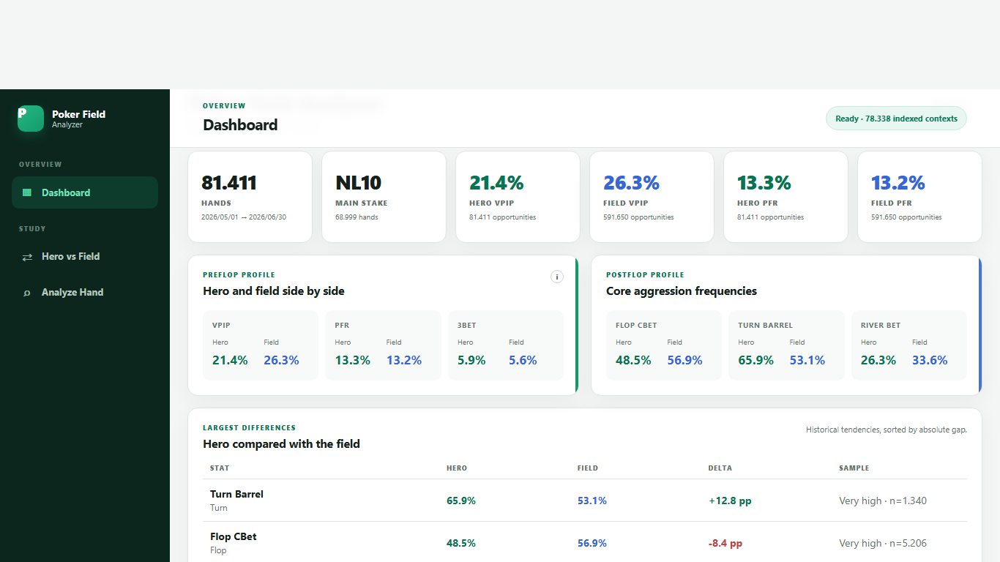

# PokerFieldAnalyzer

**Históricos de poker transformados em estatísticas auditáveis e ferramentas de estudo.**

Plataforma local de análise estatística desenvolvida com apoio de agentes de IA. O caso reúne ingestão, qualidade de dados, índices incrementais, interface e integração com um solver externo. Este repositório contém apenas documentação pública.

## O problema e a solução

Históricos de mãos são arquivos detalhados, pouco práticos para investigar tendências. Uma frequência sem contexto ou denominador pode sugerir uma conclusão incorreta; reprocessar toda a base a cada importação também encarece o uso.

O PokerFieldAnalyzer normaliza os históricos, evita contagem duplicada e calcula estatísticas com oportunidades e amostras explícitas. A interface permite comparar o jogador com o conjunto analisado e revisar mãos ou sessões fora do jogo.

## O que está implementado

- Parser auditado para históricos GGPoker; formatos desconhecidos são recusados.
- Importação com detecção de duplicatas e rastreabilidade de erros.
- Estatísticas de pré-flop, flop, turn e river, com numerador, denominador e contexto.
- Dashboard, comparação Hero vs Field e análise individual de mãos.
- Classificação de textura do board, tamanho de apostas e contexto das decisões.
- Índices históricos e de análise agregada com atualização incremental e verificações de compatibilidade.
- Revisão de sessões e decisões, com evidências estatísticas.
- Integração local com solver postflop externo, acionada explicitamente para estudo, com fila, limites e biblioteca de resultados.

O solver calcula uma solução aproximada para ranges, árvore de ações e parâmetros definidos. Uma correspondência exata na biblioteca significa identidade dos parâmetros; não garante equilíbrio exato no jogo real. Não há promessa de rentabilidade.

## Arquitetura em alto nível

## Tecnologias confirmadas

| Camada | Tecnologias identificadas |
|---|---|
| Aplicação e API | Python 3.12+, FastAPI e Uvicorn |
| Persistência | SQLite, índices derivados e cache local |
| Interface | HTML, CSS e JavaScript |
| Cálculo | Motores estatísticos determinísticos e integração com solver Rust externo |
| Validação | pytest; testes de integração e revisão de interface documentados |

O motor de solver integrado é **ucsandman/postflop**. O projeto integra esse componente; não reivindica autoria do algoritmo ou do motor externo. Nenhum binário ou código desse motor é redistribuído aqui.

## Resultados documentados

| Evidência | Resultado | Contexto |
|---|---:|---|
| Base analisada no marco M14 | **127.244 mãos** | Relatório de 03/10/2026 |
| Índice histórico no mesmo marco | **104.094 entradas** | Agregados de contexto, não usuários |
| Índice de análise agregada | **3.637.480 eventos** | Eventos derivados, não mãos distintas |
| Suíte M14 | **405 aprovados, 1 ignorado** | Execução histórica relatada; integração opcional ignorada |
| Delta de 2.000 mãos de teste | **11,32 s** | Benchmark isolado M13.1.1 com fixtures repetidas |

Os números são históricos, não uma medição da instalação atual. O benchmark inclui cópia do índice e verificações; não deve ser extrapolado para qualquer conjunto de dados. A equivalência entre reconstrução completa e incremental teve zero divergências no conjunto isolado testado. [Metodologia e limites](docs/evidencias.md).

## Interface

Captura histórica do marco 7.1, com dados agregados e sem nomes de jogadores ou mãos expostas. Os totais da imagem pertencem a um recorte anterior e diferem dos números do M14. Não é uma captura da versão atual nem evidência de desempenho financeiro.

## Desenvolvimento com agentes de IA

Usei principalmente **Codex e Kiro** no desenvolvimento dos meus projetos, com uso pontual de Gemini/Antigravity. Neste caso, os registros mostram evolução por marcos, investigação de inconsistências estatísticas, atualização incremental e validação de um motor externo.

O uso de IA está no processo de desenvolvimento assistido. As estatísticas são calculadas por regras explícitas; o solver é computação especializada, sem ser apresentado como um LLM. [Decisões e processo](docs/decisoes-e-ia.md).

## Competências demonstradas para AI Builder

Construção de uma ferramenta utilizável a partir de dados complexos; tradução de perguntas de domínio em métricas; automação de processamento; integração de componentes; otimização acompanhada de evidência e comunicação dos limites do resultado.

O estudo de caso não possui vínculo com o iFood. Históricos individuais, bancos, nomes de jogadores e código-fonte permanecem privados.
